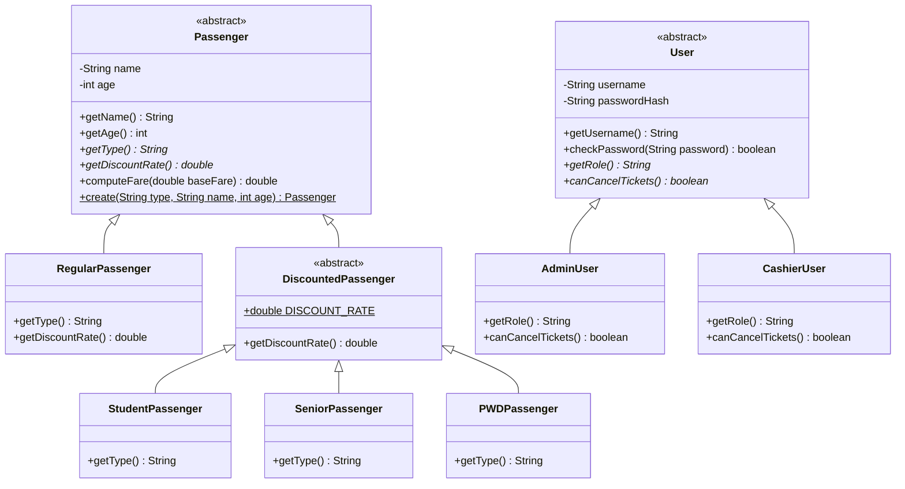
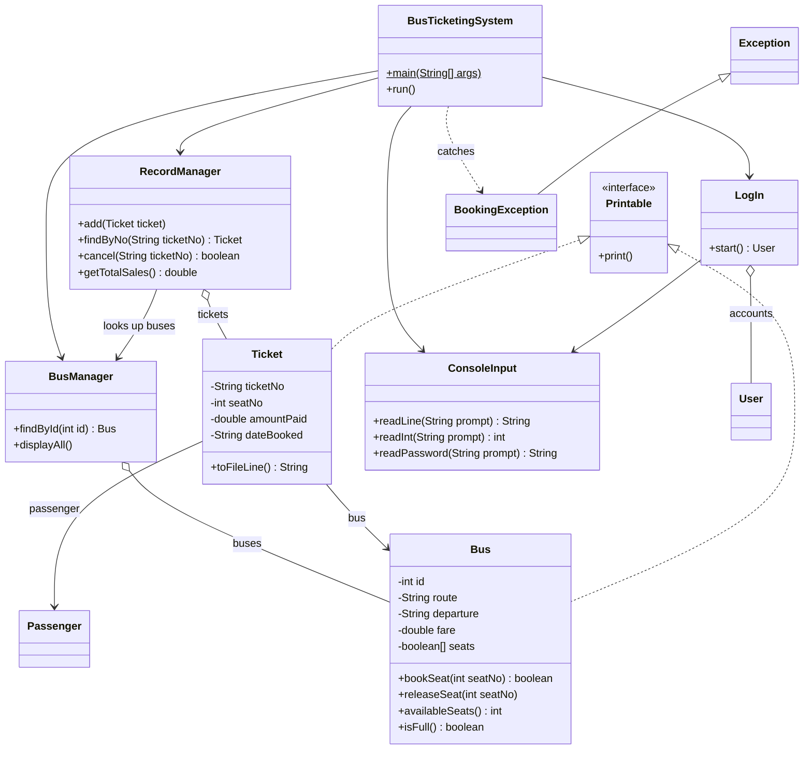

## Getting Started

Welcome to the VS Code Java world. Here is a guideline to help you get started to write Java code in Visual Studio Code.

## Folder Structure

The workspace contains two folders by default, where:

- `src`: the folder to maintain sources
- `lib`: the folder to maintain dependencies

Meanwhile, the compiled output files will be generated in the `bin` folder by default.

> If you want to customize the folder structure, open `.vscode/settings.json` and update the related settings there.

## Dependency Management

The `JAVA PROJECTS` view allows you to manage your dependencies. More details can be found [here](https://github.com/microsoft/vscode-java-dependency#manage-dependencies).

## Testing

The project uses JUnit 6 through the standalone console launcher in
`lib/junit-platform-console-standalone-6.1.3.jar`. Tests are stored alongside
the application sources under `src`.

From the project root, run these commands in PowerShell:

```powershell
$junit = "lib\junit-platform-console-standalone-6.1.3.jar"
$sources = Get-ChildItem -Path "src" -Recurse -Filter "*.java" |
    ForEach-Object { $_.FullName }

javac -cp $junit -d "bin" $sources
java -jar $junit execute --class-path "bin" --scan-class-path
```

The second command discovers and runs all compiled JUnit tests. A successful
run reports the number of tests found and passing; failures are listed with
their test names and stack traces.

src/
  app/         Main.java                          starts the program and connects the objects
  ui/          ConsoleMenu, LoginScreen, ConsoleInput, BusPrinter, TicketPrinter
  service/     BookingService, AuthService, BookingException
  repository/  BusRepository, InMemoryBusRepository, TicketRepository, FileTicketRepository
  model/       Passenger (+ Regular, Discounted, Student, Senior, PWD),
               User (+ Admin, Cashier), Bus, Ticket


               ## Project Structure

```
BusTicketingSystem/
|-- README.md
|-- .gitignore
`-- src/
    `-- edu/slsu/IT205/
        |-- BusTicketingSystem.java   main() and the menu
        |-- LogIn.java                login screen and user accounts
        |-- ConsoleInput.java         reads numbers, text and passwords safely
        |-- BookingException.java     error for an invalid booking
        |-- Printable.java            interface for printable objects
        |-- Passenger.java            abstract parent of all passengers
        |-- RegularPassenger.java     full fare
        |-- DiscountedPassenger.java  parent of the 20% discount types
        |-- StudentPassenger.java
        |-- SeniorPassenger.java
        |-- PWDPassenger.java
        |-- User.java                 abstract parent of all users
        |-- AdminUser.java            can cancel tickets
        |-- CashierUser.java          cannot cancel tickets
        |-- Bus.java                  route, fare and seats
        |-- Ticket.java               a booked ticket
        |-- BusManager.java           the list of buses
        `-- RecordManager.java        all tickets, saved in tickets.txt
```

### Package

All classes are in the package `edu.slsu.IT205`.


## Accounts and Roles

The program starts at a login screen. You have 3 attempts, and typing `exit` as the username quits.

| Username | Password | Role |
|---|---|---|
| admin | admin123 | Admin |
| cashier | cashier123 | Cashier |

### What each role can do

| Menu option | Admin | Cashier |
|---|:---:|:---:|
| View available buses | Yes | Yes |
| Book a ticket | Yes | Yes |
| View all records | Yes | Yes |
| Search a record by ticket number | Yes | Yes |
| Cancel a ticket | Yes | No |
| Logout | Yes | Yes |

A Cashier who chooses "Cancel a Ticket" sees "Access denied. Only an Admin can cancel tickets."

Passwords are not stored as plain text. Only a SHA-256 hash is kept in memory.

## Class Diagram

### Inheritance: passengers and users



### How the classes work together



**How to read the arrows**

| Arrow | Meaning |
|---|---|
| `<\|--` | inheritance ("is a"), for example a Student is a Passenger |
| `<\|..` | implements an interface |
| `o--` | has a collection of, for example BusManager has many Buses |
| `-->` | uses or holds a reference to |
| `..>` | depends on, here catching the exception |


## Features

- Book bus tickets with a chosen bus and seat number
- Four passenger types: Regular, Student, Senior and PWD. Student, Senior and PWD get 20% off
- Printed ticket shows the discount percentage and the amount paid
- Asks for confirmation before a booking is saved
- Search tickets by passenger name
- View all passengers on a bus
- Sales summary per route (Admin only)
- Login with roles, so Admin and Staff see different menus
- Records are saved in `tickets.txt` and loaded again when the program starts
- Unit tests with JUnit 5 for passengers, buses, tickets and records

## Final notes

### Project status
The project covers the main bus ticketing flow, from login to booking, searching and reporting. The commit history shows it built one small step at a time.

### What I learned
- Inheritance: `Student`, `Senior` and `PWD` extend `DiscountedPassenger`, which extends `Passenger`
- Abstraction: abstract methods such as `getType()` and `getRequiredId()`
- Polymorphism: `Ticket` works with any `Passenger` type
- Encapsulation: private fields with getters
- File handling: `|`-separated lines saved and loaded
- Unit testing: Arrange, Act, Assert with JUnit 5

### Known limitations
- Data is saved in plain text files, not a database
- It is a console app with no graphical interface
- No payment processing

### Future improvements
- Cancel or change a ticket
- A seat map for each bus
- Daily and monthly sales reports
- A graphical interface

### License
See the [LICENSE](LICENSE) file.

## How to Run

### Requirements

- A JDK (Java Development Kit), version 8 or newer. Version 17 or 21 is recommended. A JRE alone cannot compile the code.
- A terminal, or an IDE such as VS Code, NetBeans, IntelliJ or Eclipse.

Check that Java is installed. Both commands should print a version:

```
java -version
javac -version
```

If either says it is not recognized, install a JDK (for example Eclipse Temurin or Microsoft Build of OpenJDK), set `JAVA_HOME` to its folder, and add its `bin` folder to your PATH. Then close and reopen the terminal.

### Option 1: Windows terminal (PowerShell or Command Prompt)

1. Open the terminal in the project folder, the one that contains `src`. In File Explorer you can type `cmd` or `powershell` in the address bar, or use `cd`:

   ```
   cd C:\path\to\BusTicketingSystem
   ```

2. Compile:

   ```
   javac -d out src/edu/slsu/IT205/*.java
   ```

   If PowerShell does not accept the `*`, use this instead:

   ```
   javac -d out (Get-ChildItem src -Recurse -Filter *.java).FullName
   ```

3. Run:

   ```
   java -cp out edu.slsu.IT205.BusTicketingSystem
   ```

The login screen appears. Use `admin` / `admin123` or `cashier` / `cashier123`.

Compile again after you change any `.java` file.

### Option 2: VS Code

1. Install a JDK, then install the **Extension Pack for Java** from the Extensions view (Ctrl+Shift+X).
2. Open the project folder (File > Open Folder), the one that contains `src`.
3. Open `src/edu/slsu/IT205/BusTicketingSystem.java`.
4. Click **Run** above the `main` method, or press Ctrl+F5.
5. Type your input in the **Terminal** panel at the bottom.

If you cannot type into the program, the output is going to the Debug Console, which does not accept input. Add this to `.vscode/settings.json` and run again:

```json
{
  "java.debug.settings.console": "integratedTerminal"
}
```

If VS Code reports a wrong package or cannot find the other classes, add `"java.project.sourcePaths": ["src"]` to the same file.

### Option 3: NetBeans

1. Choose File > New Project > Java with Ant > **Java Project with Existing Sources**.
2. Pick the project folder, then add the `src` folder as the source package folder.
3. Right-click `BusTicketingSystem.java` and choose **Run File** (Shift+F6).
4. Type your input in the **Output** window at the bottom.

### Option 4: IntelliJ IDEA

1. Choose File > New > **Project from Existing Sources** and select the project folder.
2. Right-click the `src` folder, choose Mark Directory as > **Sources Root**.
3. Open `BusTicketingSystem.java` and click the green arrow next to `main`, then **Run**.
4. Type your input in the **Run** window at the bottom.

### Option 5: Eclipse

1. Choose File > New > **Java Project** and clear "Use default location", then pick the project folder. (Or create the project and copy the `src` folder in.)
2. Right-click `BusTicketingSystem.java` and choose Run As > **Java Application**.
3. Click inside the **Console** view and type your input there.

### Good to know

- Start the program from the project folder, or from the project root in your IDE. The `tickets.txt` file is saved in the folder the program starts in, so starting it somewhere else shows a new, empty record list.
- Some IDE consoles show the password as you type. A normal terminal hides it.
- The menus and tables are aligned for a window at least 80 characters wide, with a monospaced font.
- If something does not work, see [Troubleshooting](#troubleshooting).

## FAQ

**How do I run the program?**
From the project folder:

```
javac -d out src/edu/slsu/IT205/*.java
java -cp out edu.slsu.IT205.BusTicketingSystem
```

In an IDE such as NetBeans, Eclipse, IntelliJ or VS Code, run the `BusTicketingSystem` class.

**What are the login accounts?**

| Username | Password | Role |
|----------|----------|------|
| admin | admin123 | Admin |
| cashier | cashier123 | Cashier |

The username is not case sensitive, but the password is.

**Why did the program close after I typed the wrong password?**
After 3 wrong attempts the program closes for safety. Start it again and log in with the correct password.

**How do I quit?**
Type `exit` as the username on the login screen. Option `[6] Logout` in the main menu takes you back to the login screen.

**What is the difference between Admin and Cashier?**
Both can view buses, book tickets, view all records and search for a ticket. Only an Admin can cancel a ticket. A Cashier who chooses Cancel sees `Access denied. Only an Admin can cancel tickets.`

**How much is the discount?**
Students, Seniors and PWD passengers get 20% off the full fare. Regular passengers pay the full fare. For example, on a P200.00 bus a student pays P160.00. The printed ticket shows the discount percentage and the amount paid. Discounted passengers are expected to show a valid ID when boarding.

**Why can't I choose a seat?**
Taken seats show `XX` on the seat map. Choose a seat number that is still free, from 1 to 20.

**Why was my age rejected?**
The age must be a whole number from 1 to 120. The program shows a message and returns to the main menu. Nothing is saved until the ticket is printed, so start the booking again with option 2.

**Where are the tickets saved?**
In `tickets.txt`, one ticket per line, with the fields separated by `|`. The program reads the file when it starts, so your tickets are still there next time. If you type a `|` in a passenger name, it is replaced by a space so it cannot break the file.

**How do I clear all tickets?**
Close the program and delete `tickets.txt`. This cannot be undone. The program starts again with no tickets.

**Can I search with lowercase letters?**
Yes. `tkt-1001` and `TKT-1001` both find the same ticket.

**Can I cancel a ticket?**
Yes, as an Admin, with option 5. The program asks you to confirm with `y`, and cancelling frees the seat so it can be booked again.

**Where can I learn more?**
- [User guide](docs/USER_GUIDE.md): every screen and what to type
- [Sample run](docs/SAMPLE_RUN.md): an example session
- [Architecture](docs/ARCHITECTURE.md): the classes and how they fit together
- [OOP concepts](docs/OOP_CONCEPTS.md): where encapsulation, inheritance, polymorphism and abstraction are used

## Troubleshooting

### Build and run problems

**`'javac' is not recognized` (or `The term 'javac' is not recognized` in PowerShell)**
Java is missing, or it is not on your PATH. `javac` comes with the JDK, so a JRE alone is not enough.
1. Run `java -version` and `javac -version`. Both should print a version.
2. If not, install a JDK, set `JAVA_HOME` to its folder, and add its `bin` folder to your PATH.
3. Close and reopen the terminal, then try again.

**`Error: Could not find or load main class edu.slsu.IT205.BusTicketingSystem`**
- Run the commands from the project folder, the one that contains `src`.
- Compile first. The `out` folder must exist and contain the compiled classes.
- Use the full class name with dots, not slashes: `edu.slsu.IT205.BusTicketingSystem`.
- The `-cp out` part must be there.

**`javac` says `file not found: src/edu/slsu/IT205/*.java` (or the `*` is not expanded)**
Some terminals do not expand the `*`. In PowerShell, compile with:

```
javac -d out (Get-ChildItem src -Recurse -Filter *.java).FullName
```

**`error: package org.junit.jupiter.api does not exist`**
A test file such as `TicketTest.java` is inside `src`, and plain `javac` has no JUnit. Either move the tests to a separate `test` folder, or leave them out of the build:

```
javac -d out (Get-ChildItem src -Recurse -Filter *.java | Where-Object { $_.Name -notlike '*Test.java' }).FullName
```

**`UnsupportedClassVersionError`**
The classes were compiled with a newer JDK than the one running them. Use the same JDK for `javac` and `java`. `java -version` and `javac -version` should show the same major version.

**`'mvn' is not recognized`**
Maven is not installed or not on your PATH. You do not need Maven to run this program. To run the tests, use your IDE's test runner, or install Maven and add its `bin` folder to your PATH.

### Compile errors after editing

**`class X is public, should be declared in a file named X.java`,