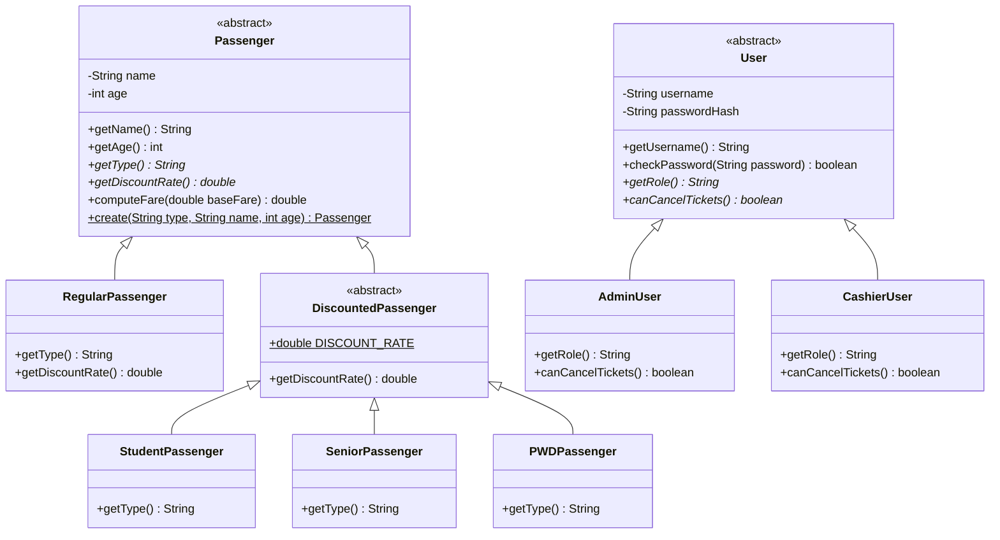
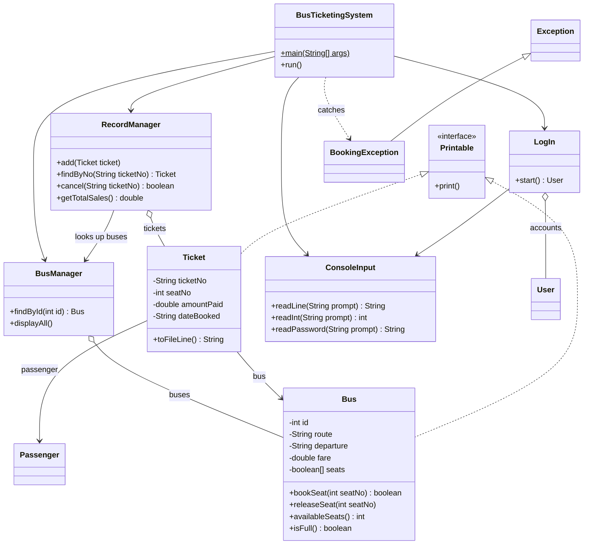

## Getting Started

Welcome to the VS Code Java world. Here is a guideline to help you get started to write Java code in Visual Studio Code.

## Folder Structure

The workspace contains two folders by default, where:

- `src`: the folder to maintain sources
- `lib`: the folder to maintain dependencies

Meanwhile, the compiled output files will be generated in the `bin` folder by default.

> If you want to customize the folder structure, open `.vscode/settings.json` and update the related settings there.

## Dependency Management

The `JAVA PROJECTS` view allows you to manage your dependencies. More details can be found [here](https://github.com/microsoft/vscode-java-dependency#manage-dependencies).

## Testing

The project uses JUnit 6 through the standalone console launcher in
`lib/junit-platform-console-standalone-6.1.3.jar`. Tests are stored alongside
the application sources under `src`.

From the project root, run these commands in PowerShell:

```powershell
$junit = "lib\junit-platform-console-standalone-6.1.3.jar"
$sources = Get-ChildItem -Path "src" -Recurse -Filter "*.java" |
    ForEach-Object { $_.FullName }

javac -cp $junit -d "bin" $sources
java -jar $junit execute --class-path "bin" --scan-class-path
```

The second command discovers and runs all compiled JUnit tests. A successful
run reports the number of tests found and passing; failures are listed with
their test names and stack traces.

src/
  app/         Main.java                          starts the program and connects the objects
  ui/          ConsoleMenu, LoginScreen, ConsoleInput, BusPrinter, TicketPrinter
  service/     BookingService, AuthService, BookingException
  repository/  BusRepository, InMemoryBusRepository, TicketRepository, FileTicketRepository
  model/       Passenger (+ Regular, Discounted, Student, Senior, PWD),
               User (+ Admin, Cashier), Bus, Ticket


               ## Project Structure

```
BusTicketingSystem/
|-- README.md
|-- .gitignore
`-- src/
    `-- edu/slsu/IT205/
        |-- BusTicketingSystem.java   main() and the menu
        |-- LogIn.java                login screen and user accounts
        |-- ConsoleInput.java         reads numbers, text and passwords safely
        |-- BookingException.java     error for an invalid booking
        |-- Printable.java            interface for printable objects
        |-- Passenger.java            abstract parent of all passengers
        |-- RegularPassenger.java     full fare
        |-- DiscountedPassenger.java  parent of the 20% discount types
        |-- StudentPassenger.java
        |-- SeniorPassenger.java
        |-- PWDPassenger.java
        |-- User.java                 abstract parent of all users
        |-- AdminUser.java            can cancel tickets
        |-- CashierUser.java          cannot cancel tickets
        |-- Bus.java                  route, fare and seats
        |-- Ticket.java               a booked ticket
        |-- BusManager.java           the list of buses
        `-- RecordManager.java        all tickets, saved in tickets.txt
```

### Package

All classes are in the package `edu.slsu.IT205`.


## Accounts and Roles

The program starts at a login screen. You have 3 attempts, and typing `exit` as the username quits.

| Username | Password | Role |
|---|---|---|
| admin | admin123 | Admin |
| cashier | cashier123 | Cashier |

### What each role can do

| Menu option | Admin | Cashier |
|---|:---:|:---:|
| View available buses | Yes | Yes |
| Book a ticket | Yes | Yes |
| View all records | Yes | Yes |
| Search a record by ticket number | Yes | Yes |
| Cancel a ticket | Yes | No |
| Logout | Yes | Yes |

A Cashier who chooses "Cancel a Ticket" sees "Access denied. Only an Admin can cancel tickets."

Passwords are not stored as plain text. Only a SHA-256 hash is kept in memory.

## Class Diagram

### Inheritance: passengers and users



### How the classes work together



**How to read the arrows**

| Arrow | Meaning |
|---|---|
| `<\|--` | inheritance ("is a"), for example a Student is a Passenger |
| `<\|..` | implements an interface |
| `o--` | has a collection of, for example BusManager has many Buses |
| `-->` | uses or holds a reference to |
| `..>` | depends on, here catching the exception |
