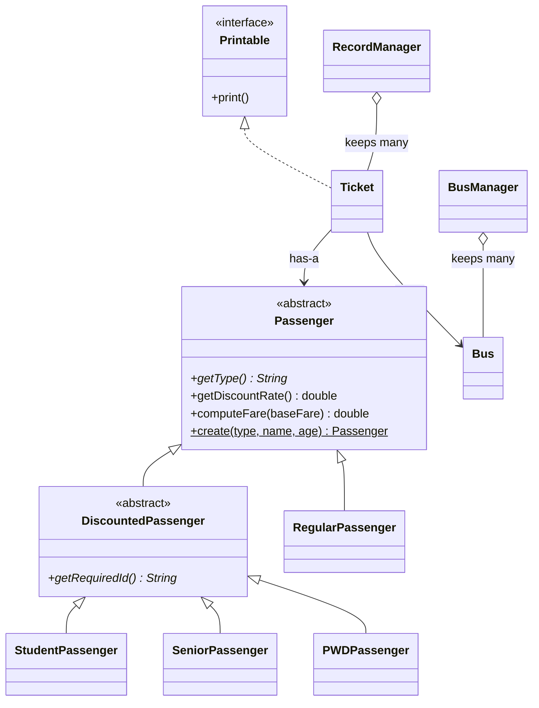

# Architecture

The Bus Ticketing System is a console application written in Java. All classes live in one package, `edu.slsu.IT205`. They fall into three roles:

- **Entry point:** `BusTicketingSystem` shows the login screen and menus and reads what the user types.
- **Model:** classes that describe the real-world things: passengers, buses, tickets and users.
- **Managers:** classes that hold collections of model objects and handle searching and saving.

## Project layout

```
src/edu/slsu/IT205/
    BusTicketingSystem.java     entry point: login, menu, user input
    User.java                   login account with a role
    Printable.java              interface: anything that can print itself
    Passenger.java              abstract base class for all passengers
    DiscountedPassenger.java    abstract middle class: 20% discount
    RegularPassenger.java       full fare
    StudentPassenger.java       discounted
    SeniorPassenger.java        discounted
    PWDPassenger.java           discounted
    Bus.java                    route, fare and seats
    BusManager.java             the list of buses
    Ticket.java                 one booking
    RecordManager.java          all tickets, saved in tickets.txt
docs/                           documentation
tickets.txt                     saved tickets, created when the program runs
```

## Class diagram



## What each class does

| Class | Kind | Responsibility |
|-------|------|----------------|
| `BusTicketingSystem` | Entry point | Shows the login screen and main menu, reads input, and calls the managers |
| `User` | Model | A login account: username, password and role (Admin or Cashier) |
| `Printable` | Interface | Promises a `print()` method |
| `Passenger` | Abstract class | Holds the name and age, and works out the fare. Each subclass supplies `getType()` |
| `DiscountedPassenger` | Abstract class | Gives the 20% discount to its subclasses, and requires each one to say which ID to show when boarding (`getRequiredId()`) |
| `RegularPassenger` | Class | A passenger who pays the full fare |
| `StudentPassenger`, `SeniorPassenger`, `PWDPassenger` | Classes | Passengers who get 20% off |
| `Bus` | Model | One bus: id, route, departure, fare and seats |
| `BusManager` | Manager | Keeps the list of buses and finds one by its id |
| `Ticket` | Model, `Printable` | One booking: ticket number, passenger, bus, seat, amount paid and date |
| `RecordManager` | Manager | Keeps all tickets, searches them, prints the records table, and saves and loads `tickets.txt` |

## How a booking works

1. The user chooses **Book a Ticket** in `BusTicketingSystem`.
2. The program finds the chosen bus through `BusManager`.
3. `Passenger.create(...)` builds the right passenger subclass from the chosen type.
4. `new Ticket(...)` asks the passenger for the fare (`computeFare`), which applies the discount. A student pays the bus fare minus 20%.
5. The seat is marked as taken on the `Bus`.
6. `RecordManager` stores the ticket and saves it to `tickets.txt`.
7. `ticket.print()` shows the receipt.

## How data is saved

Each ticket is one line in `tickets.txt`, with eight fields separated by `|`:

| # | Field | Example |
|---|-------|---------|
| 1 | Ticket number | `TKT-1001` |
| 2 | Passenger name | `Juan Dela Cruz` |
| 3 | Age | `20` |
| 4 | Passenger type | `Student` |
| 5 | Bus id | `1` |
| 6 | Seat number | `5` |
| 7 | Amount paid | `160.0` |
| 8 | Date booked | `2026-11-07 14:30` |

When the program starts, it reads each line and rebuilds the ticket. `Passenger.create(...)` makes the passenger from fields 2 to 4. `BusManager` finds the bus from field 5. The second `Ticket` constructor keeps the saved amount and date, so an old ticket never changes if the fare changes later. A `|` typed inside a name is replaced by a space so it cannot break the format.

## Design decisions

- **`Passenger` is abstract.** There is no such thing as a plain passenger, only a regular, student, senior or PWD one. Each type must define its own `getType()`.
- **`DiscountedPassenger` sits between them.** The 20% rate is written once in `DiscountedPassenger`. To change it, edit one constant.
- **`Passenger.create(...)` is a factory method.** The code that loads `tickets.txt` only has the type as text, such as `"Student"`. The factory turns that text into the right object.
- **`Ticket` has two constructors.** One makes a new booking with today's date. The other restores a saved booking exactly as it was.
- **`Ticket` has a passenger and a bus.** It stores references to them instead of copying their fields (composition).
- **`Printable` is an interface.** Code that only needs to print something can work with any `Printable`, without knowing its class.